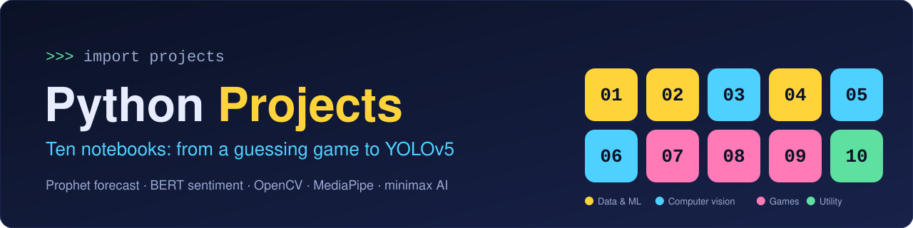
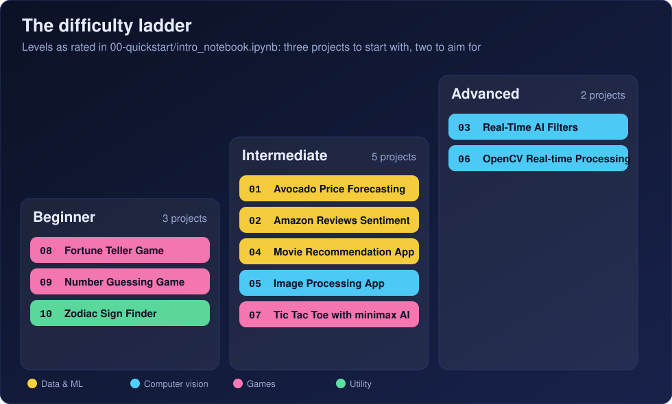
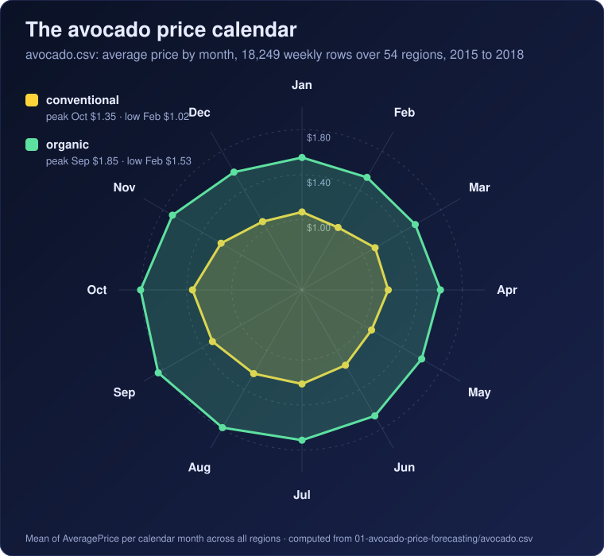
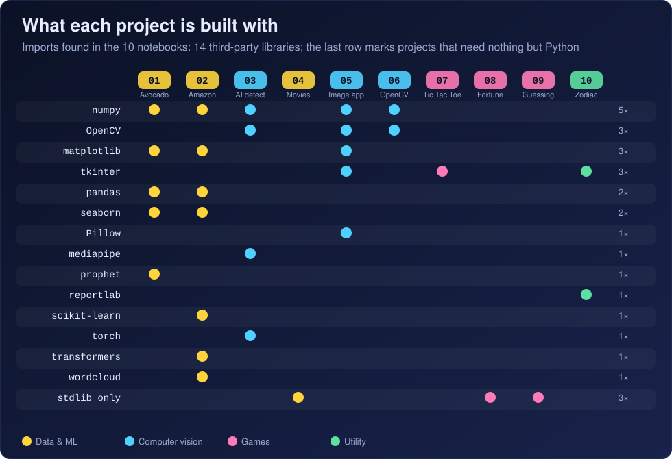

<p align="center">
  
  
  
  
  <a href=".github/workflows/notebooks-run.yml"></a>
  
</p>

This is where the foundations were laid. Ten small projects built while learning Python: a guessing game, a fortune teller, a Tic Tac Toe that cannot be beaten, then pandas, Prophet, BERT, OpenCV and YOLOv5. Each project is a numbered folder with one notebook and its own README. The production work that came after lives in the [main portfolio](https://github.com/evgeniimatveev).

> *"Ten notebooks, one habit: start with something that runs, then make it a little more ambitious."*

---

## The projects

| # | Project | What it does | Level | Runs in CI |
|:-:|---------|--------------|:-----:|:----------:|
| 01 | [Avocado Price Forecasting](01-avocado-price-forecasting/) | EDA and a Prophet forecast of avocado prices: trend and seasonality | intermediate | ✅ |
| 02 | [Amazon Reviews Analysis](02-amazon-reviews-analysis/) | NLP pipeline on Alexa reviews: TF-IDF, logistic regression, BERT sentiment, word clouds | intermediate | ⏭️ data not in repo (Kaggle) |
| 03 | [Real-Time AI Detection & Filters](03-real-time-ai-detection/) | YOLOv5 objects + MediaPipe hands and pose + 9 live filters and a particle system | advanced | ⏭️ needs webcam, PyTorch, MediaPipe |
| 04 | [Movie Recommendation App](04-movie-recommendation/) | Age-based movie picker with 16 age groups and trending titles | intermediate | ✅ |
| 05 | [Image Processing App](05-image-processing-app/) | Nine OpenCV effects with a tkinter GUI: load, apply, save | intermediate | ✅ GUI is built |
| 06 | [OpenCV Real-time Webcam Effects](06-opencv-realtime-effects/) | Nine live webcam filters with keyboard switching and an FPS overlay | advanced | ✅ all but the webcam loop |
| 07 | [Tic Tac Toe — Minimax AI](07-tic-tac-toe/) | Tic Tac Toe with an unbeatable minimax AI, five themes, boards from 3x3 to 6x6 | intermediate | ✅ window is built |
| 08 | [Mystic Oracle Fortune Teller](08-fortune-teller/) | Mystic oracle: pick a colour and a number, get a fortune (7% are legendary) | beginner | ✅ |
| 09 | [Guess the Number](09-guessing-game/) | Number guessing game: three levels, adaptive hints, ASCII victory art | beginner | ✅ |
| 10 | [Zodiac & Numerology Analyzer](10-zodiac-sign-finder/) | Zodiac sign plus numerology, lucky colour and element, PDF export | beginner | ✅ window is built |

Plus [`00-quickstart/`](00-quickstart/): a tiny script and an intro notebook that list all the projects and sort them by level.

---

## What the repo shows

### Climb it in this order



The levels are the ones from [`00-quickstart/intro_notebook.ipynb`](00-quickstart/intro_notebook.ipynb): 3 beginner, 5 intermediate, 2 advanced. Start with the games, they need nothing but Python.

### A real dataset: avocado prices



Organic avocados cost about 43% more than conventional ones all year. Both are cheapest in Feb (organic $1.53, conventional $1.02) and get expensive in autumn: organic peaks in Sep at $1.85, conventional in Oct at $1.35. This yearly cycle is exactly what the Prophet model in [project 01](01-avocado-price-forecasting/) learns as its seasonality component.

### What it takes to run each one



Three projects need only the standard library, `numpy` appears in five, and the heavy tools (`torch`, `transformers`, `mediapipe`, `prophet`) are each used in exactly one project.

---

## Repository layout

```
Python-Projects/
├── 00-quickstart/                 # hello_projects.py + intro_notebook.ipynb
├── 01-avocado-price-forecasting/  # one folder per project:
│   ├── avocado_price_forecasting.ipynb   #   the notebook
│   ├── avocado.csv                       #   its data, if it has any
│   └── README.md                         #   what it does, how to run it
├── 02-amazon-reviews-analysis/
├── ...
├── 10-zodiac-sign-finder/
├── assets/                        # README banner and charts
└── .github/                       # CI
```

**Why folders instead of branches?** Every project used to live in its own git branch, so the repository looked almost empty on `main`. Now it is one `main` with numbered folders, and the commit history of every old branch is kept in the commit graph.

---

## How to run

```bash
git clone https://github.com/evgeniimatveev/Python-Projects.git
cd Python-Projects/09-guessing-game       # any project folder
uv run --with jupyter jupyter notebook    # open the notebook and run the cells
```

Each project README lists the extra packages it needs, for example `uv pip install prophet plotly seaborn pandas matplotlib` for the avocado forecast. The notebooks are saved without outputs, so you see the charts and the game text only after running them.

---

## Continuous integration

| Workflow | When | What it does |
|----------|------|--------------|
| [`notebook-check.yml`](.github/workflows/notebook-check.yml) | every push and pull request | Validates every notebook, parses every code cell, checks that the data and image files a notebook reads exist, and that README links work |
| [`notebooks-run.yml`](.github/workflows/notebooks-run.yml) | **manual**: Actions → *Notebooks run (manual)* → *Run workflow* | Executes the notebooks that can run on their own (see below) |

Last full run: **9 of 11 notebooks executed, 0 failed**. To make the interactive ones runnable, the manual run feeds scripted answers to `input()`, skips `time.sleep()`, and builds each tkinter window under a virtual display and closes it at once. These patches live only in the test runner; the notebooks are untouched.

---

## Known limitations

- **Two notebooks are not executed in CI.** [`02`](02-amazon-reviews-analysis/) needs `amazon_alexa.tsv`, which is a Kaggle download and is not in the repo; [`03`](03-real-time-ai-detection/) needs a webcam, PyTorch and MediaPipe.
- **Webcam and GUI code is only partly tested.** In [`06`](06-opencv-realtime-effects/) the filter functions run but the live webcam loop does not; the tkinter windows of `05`, `07` and `10` are built but nobody clicks them.
- **`05` ships a generated test image.** `sample.jpg` is a small synthetic picture added so the effects demo works out of the box; point `IMAGE_PATH` to your own photo to see the effects on it. It also needs `opencv-contrib-python` for the oil-painting effect.
- **Older versions of two projects are history only.** The first Feb-2025 versions (including a FastAPI and Streamlit guide for the avocado data and the Region of Interest Selection and Cartoon Effect notebooks) are no longer in the tree, but all of those commits stay reachable in the git history.
- **Notebook cell ids.** The notebooks declare format 4.5 but their cells have no `id` field; GitHub renders them fine, and newer tools may add the ids on first save.

---

## Tech stack

| Category | Tools |
|----------|-------|
| Data & ML | pandas · numpy · scikit-learn · Prophet |
| NLP | transformers (BERT) · TF-IDF · WordCloud |
| Computer vision | OpenCV · YOLOv5 · MediaPipe |
| Visualization | matplotlib · seaborn · plotly |
| GUI | tkinter · Pillow |
| Tooling | uv · Jupyter · GitHub Actions |

---

## What came next

After these foundations: production data pipelines, deployed dashboards, MLOps systems and an AI-powered MCP analytics agent. See the [full portfolio](https://github.com/evgeniimatveev).

---

*Built by [Evgenii Matveev](https://github.com/evgeniimatveev) · Data Analyst / Analytics & MLOps Engineer*
